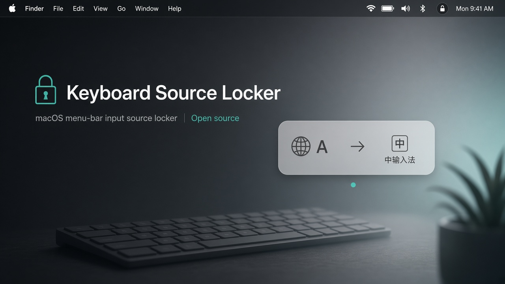
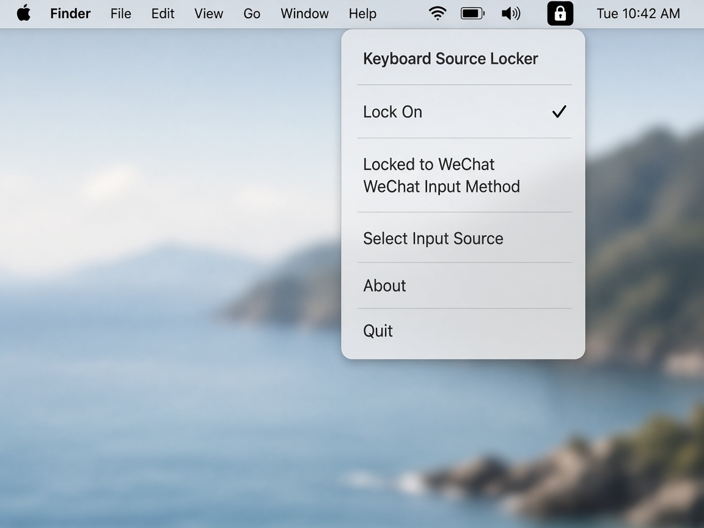
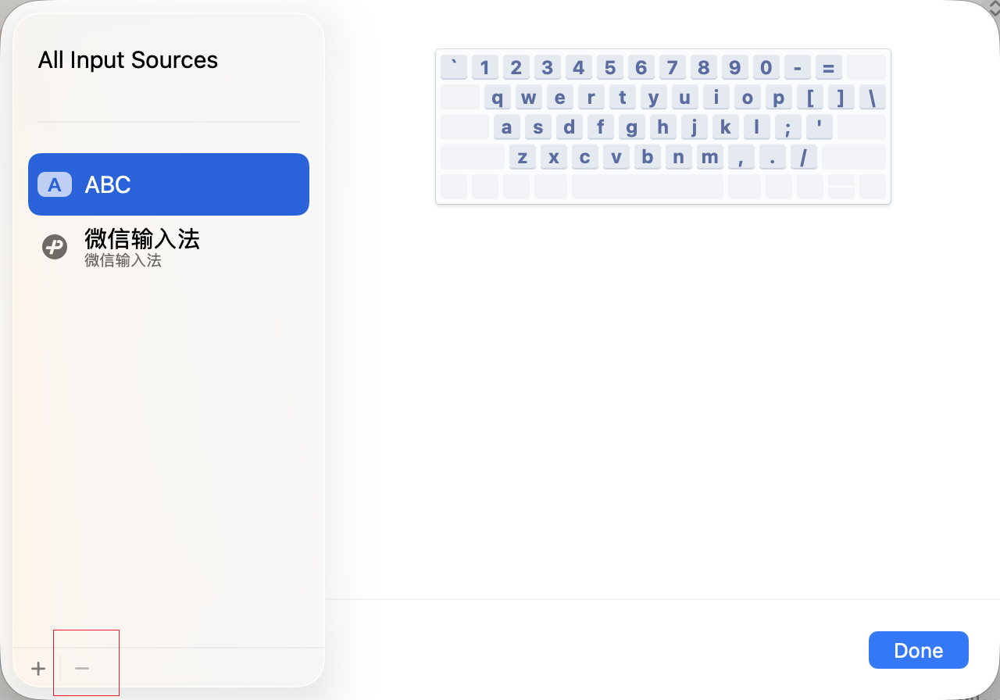
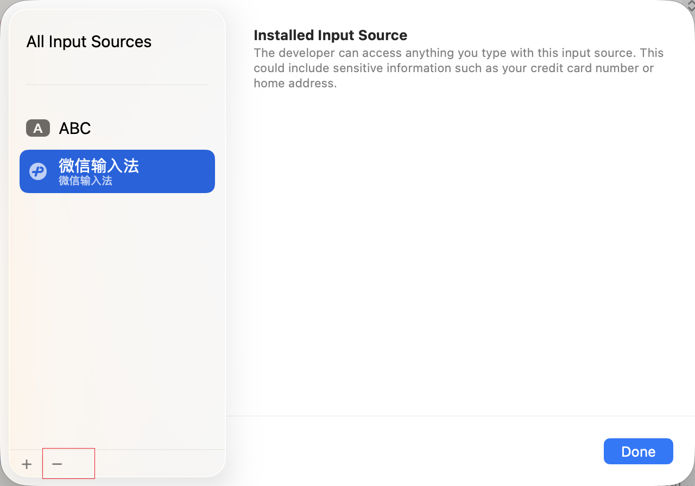

# Keyboard Source Locker

[](https://github.com/heyq02/keyboard-source-locker/actions/workflows/test.yml)
[](https://github.com/heyq02/keyboard-source-locker/actions/workflows/release.yml)
[](LICENSE)
[](https://github.com/heyq02/keyboard-source-locker)
[](https://swift.org)

A tiny macOS **menu-bar** utility that locks your active keyboard input source to the one you choose.

macOS will not let you remove the built-in **ABC** layout, so the system can switch to it unexpectedly. Keyboard Source Locker watches for those switches and restores your preferred source after a short debounce.

<p align="center">
  
</p>

<p align="center">
  
</p>

<details>
<summary>Problem evidence (System Settings)</summary>
<p align="center">
  
  
</p>
</details>

## Features

- Lock to **any installed, selectable** keyboard input source
- **Global** lock (same target in every app)
- **Short debounce** (200 ms) so brief intentional switches are less likely to fight the locker
- Menu-bar controls: status, toggle, target picker, quit
- Persists lock state and target across launches
- Filters out palette sources (Emoji, Press & Hold) and non-selectable IME parents

## Install

### From a GitHub Release (recommended)

1. Open the latest [Release](https://github.com/heyq02/keyboard-source-locker/releases/latest)
2. Download `KeyboardSourceLocker-v*-macos.zip`
3. Unzip and move `KeyboardSourceLocker.app` to `/Applications`
4. Launch it (menu-bar lock icon; no Dock icon)

First launch from the internet may require **System Settings → Privacy & Security → Open Anyway**.

### Build from source

```bash
git clone https://github.com/heyq02/keyboard-source-locker.git
cd keyboard-source-locker
pnpm install
vp run package
open dist/KeyboardSourceLocker.app
```

Requirements: **macOS 14+**, Swift **6.2+**, Node.js **18+**, [pnpm](https://pnpm.io) (via `packageManager` / Corepack).

## Usage

1. Click the menu-bar lock icon
2. **Select Input Source** → pick your preferred source (e.g. 微信输入法)
3. Turn **Lock: On**
4. Switch to ABC (menu bar or shortcut) — after ~200 ms it should snap back

| Menu item           | Action                                               |
| ------------------- | ---------------------------------------------------- |
| Lock: On / Off      | Enable or disable restoring                          |
| Locked to: …        | Shows the current locked target                      |
| Select Input Source | Choose the locked target                             |
| Launch at Login     | Start the app automatically when you log in to macOS |
| Version …           | Shows the current app version                        |
| About               | Opens the project page                               |
| Quit                | Stop monitoring and exit                             |

> **Launch at Login** works best with the packaged `.app` (for example after `vp run package` or a GitHub Release install). If macOS asks for approval, allow it under **System Settings → General → Login Items**.

## Development

Node toolchain is **[Vite+](https://viteplus.dev)** (`vp`). Swift tasks live in `vite.config.ts` → `run.tasks`.

```bash
pnpm install
vp run test      # CoreTestRunner
vp run version   # print version from package.json (via Swift VersionTool)
vp run build     # compile the app
vp run start     # run via SwiftPM
vp run package   # dist/KeyboardSourceLocker.app (Swift reads package.json)
vp run check     # debug compile smoke check
vp run clean     # remove .build and dist
```

Version lives in **`package.json`**. Packaging helpers are Node ESM under `scripts/*.mjs`; orchestrate them with `vp run`. Swift still owns compile + `VersionTool`.

```bash
pnpm install
pnpm run release   # bumpp → commit, tag vX.Y.Z, push
```

Release notes on GitHub are generated by [`changelogithub`](https://github.com/antfu/changelogithub) from commits since the previous tag (Conventional Commits work best: `feat:`, `fix:`, `chore:`…).

Core logic is covered by a CLT-friendly test harness (`swift run CoreTestRunner`) because Swift Testing / XCTest are unreliable under Command Line Tools alone.

Product intent lives in [docs/DEMAND.md](docs/DEMAND.md) and [docs/PRD.md](docs/PRD.md). Technical overview: [docs/ARCHITECTURE.md](docs/ARCHITECTURE.md).

## CI & releases

| Workflow                                 | Trigger         | What it does                                                                                         |
| ---------------------------------------- | --------------- | ---------------------------------------------------------------------------------------------------- |
| [Test](.github/workflows/test.yml)       | Every push / PR | Runs tests and compiles the app                                                                      |
| [Release](.github/workflows/release.yml) | Git tags `v*` | Tests, packages `.app`, **changelogithub** notes, Release assets, GHCR package |

```bash
git tag v1.0.0
git push origin v1.0.0
```

The release attaches `KeyboardSourceLocker-vX.Y.Z-macos.zip`, its SHA-256, and the raw `KeyboardSourceLockerApp` binary.

### GitHub Packages (GHCR)

After each `v*` tag, the macOS zip is also published as an OCI artifact:

```bash
# requires: https://oras.land
oras pull ghcr.io/heyq02/keyboard-source-locker/macos:v0.0.4
# or
oras pull ghcr.io/heyq02/keyboard-source-locker/macos:latest
```

If the package does not appear publicly, open the package on GitHub → **Package settings** → set visibility to **Public**.

## Contributing

Bugs, ideas, and PRs are welcome — see [CONTRIBUTING.md](CONTRIBUTING.md).

Please read the [Code of Conduct](CODE_OF_CONDUCT.md) and [Security policy](SECURITY.md).

## License

[MIT](LICENSE) © Ari He
